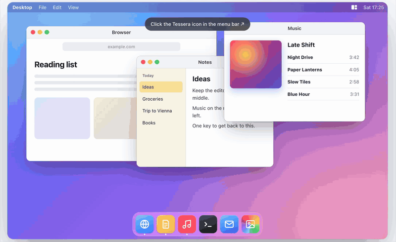

# Tessera

Tessera is a small menu bar app for macOS. It arranges your windows into saved layouts, called modes. When you resize one arranged window, the windows next to it resize with it.

Tessera is free and open source under the [MIT License](LICENSE). You build it yourself from source. It is not on the Mac App Store, and you do not need an Apple Developer account.



## Install

Run this in Terminal:

```sh
curl -fsSL https://raw.githubusercontent.com/Asm3r96/tessera/main/install.sh | bash
```

1. The script downloads the latest release, puts Tessera in `~/Applications` and starts it.
2. Allow Tessera in System Settings › Privacy & Security › Accessibility. macOS asks once.
3. Press ⌃⌥1 to test.

Tessera checks for updates once a day. When a new version is out, the menu bar icon shows a small dot. Open the panel and click **Update**. Tessera downloads the new version, checks its signature, and restarts. You can also run the install command again. The Accessibility permission stays either way.

Tessera needs macOS 14 Sonoma or later. It runs on Apple silicon and Intel.

To start Tessera again after you quit it, search for "Tessera" in Spotlight. To start it every time you log in, turn on **Open at login** in its menu. Tessera has no Dock icon. It lives only in the menu bar.

## Build from source

You need the Apple Command Line Tools. Xcode is not required. To check, run `swift --version`. If the command is missing, run `xcode-select --install`.

1. Clone and install:

   ```sh
   git clone https://github.com/Asm3r96/tessera.git ~/dev/tessera
   cd ~/dev/tessera
   ./build.sh install
   ```

2. On the first build, macOS shows a keychain prompt for `codesign`. Type your Mac password and click **Always Allow**.
3. Allow Tessera under Privacy & Security › Accessibility.

To update a source build, run `git pull && ./build.sh install`.

| Command | Result |
| --- | --- |
| `./build.sh` | Builds and signs `.build/app/Tessera.app` for Apple silicon and Intel. |
| `./build.sh install` | Builds, copies the app to `~/Applications`, and starts it. |
| `VERSION=0.2.0 ./build.sh release` | Builds `.build/app/Tessera.zip` for a release. |
| `swift build` | Compiles only. Use it to check for compile errors. |
| `swift run TesseraChecks` | Runs the logic checks for layouts and linked resizing. |

## Signing

macOS links the Accessibility permission to the app's signature. A normal local (ad-hoc) signature changes on every build, so macOS would ask for permission after every rebuild.

To prevent this, `build.sh` creates a self-signed certificate called **Tessera Local Signing** in your login keychain. It does this once on each Mac. Every later build uses the same certificate, so the permission stays.

Each Mac gets its own certificate. You approve Accessibility once on each Mac.

Releases use a separate certificate, **Tessera Release Signing**, stored as a GitHub secret. Every release has the same signature, so users who install with the command above keep the permission across updates. A source build and a release build have different signatures. If you switch between them, macOS asks for Accessibility again.

## Releases

1. Push a version tag, for example `git tag v0.2.0 && git push origin v0.2.0`.
2. The Release workflow runs the checks, builds a universal `Tessera.zip`, signs it and publishes a GitHub Release.
3. `install.sh` always downloads the latest release.

The workflow needs two repository secrets: `TESSERA_SIGNING_P12` (the base64 `.p12` file) and `TESSERA_SIGNING_PASSWORD`. Keep a private backup of the `.p12` file. If you lose it, the next release has a new signature and every user must allow Accessibility again.

## Use

- Click the menu bar icon, then click a mode. Tessera arranges the windows on the screen under the mouse.
- Press ⌃⌥1 to ⌃⌥9 to apply the mode at that position in the list.
- Hover a mode card to preview it. The screen shows each zone with the app and window that will go there.
- The frontmost window goes into the largest zone. The next windows fill the other zones. When there are more windows than zones, the extra windows join the zones as tabs. When you switch modes on the same screen, the tiled windows stay in their order.
- Drag the edge between two arranged windows. Every window on that edge resizes with it.

### Swap, replace and free windows

When a mode is applied, drag any window by its title bar. The zones appear on screen. Each zone has a drop target in its center, about 60% of the zone. Rest the pointer on a target for a moment: it lights up and shows what the drop will do. A quick drag across the screen never triggers a target.

- **Swap:** drag a tiled window onto another zone. The two windows change places and keep the zone sizes.
- **Replace:** drag a new window, for example Spotify, onto a zone. It takes that zone. The old window stays where it is, behind.
- **Move here:** drag a window onto an empty zone to fill it.
- **Add as tab:** hold Command while you drop. The window joins that zone as a tab and shows on top. The window that was there waits behind it, at the same size.
- **Float:** drop anywhere outside the targets, for example near a zone's edge. The screen shows "Float here". The window stays where you drop it, above your tiles, and a tiled window leaves the layout. This is useful for a quick Finder window. Hide it again with ⌘H.
- Holding Option while you drop also floats the window.

### Tabs

A zone can hold more than one window. The windows share the zone's size and place, and one of them shows.

- **Marks:** a zone with tabs shows small marks on its top edge, one per window. Click a mark to show that window.
- **Tab bar:** rest the pointer on the marks. A bar opens with each window's app icon and title. Click a tab to show it, or use ‹ and ›.
- **Keyboard:** press ⌃⌥` for the next tab and ⌃⌥⇧` for the previous tab. Tessera uses the zone of the active window, or else the zone under the pointer.
- **Close:** rest the pointer on a tab and click ×. The app closes the window the usual way, so it asks you to save unsaved work first.
- **Move:** drag a tab out of the bar onto another zone's center target. It joins that zone as a tab.
- **Stays in sync:** a click, ⌘-Tab or the Dock can bring a tab forward, and the bar follows. When you close or minimize the shown tab, the next window in that zone shows. Resizing a zone resizes all of its tabs.

- Use the **Gap** slider to set the space between windows.
- Turn on **Open at login** to start Tessera when you log in.
- Turn off **Check for updates** to stop the daily update check. This switch appears only in release builds.

### Add or edit a mode

1. Click the menu bar icon.
2. Click **+** for a new mode. To edit a mode, hover over its card and click the sliders icon.
3. Set the name, the columns (up to 5), the width of each column, and the rows in each column (1 to 4).
4. Click **Save**.

Modes are saved in the app's user defaults (`com.moe.tessera`). They do not sync between Macs.

## Troubleshooting

| Problem | Fix |
| --- | --- |
| `./build.sh` hangs at the signing step | macOS is waiting at a hidden keychain prompt. Find it, type your password, and click **Always Allow**. |
| Shortcuts do nothing | Turn on Tessera under Privacy & Security › Accessibility. Then quit Tessera from its menu and open it again. |
| Tessera is on in Accessibility but windows do not move | The permission belongs to an old signature. Run `tccutil reset Accessibility com.moe.tessera`, start Tessera, and allow it again. |
| `ld: warning: search path ... not found` | This warning is harmless with the Command Line Tools. Ignore it. |
| Spotlight opens something else for "Tessera" | Use the result with the Tessera icon, or start it with `open ~/Applications/Tessera.app`. |
| Zones do not appear when you drag a window | Apply a mode first. Drag the window by its title bar, not by its edge. |
| A window does not get the full zone size | Some apps have a minimum window size. Tessera cannot make them smaller. |

## Project layout

| Path | Contents |
| --- | --- |
| `Sources/TesseraCore/` | Layout math, linked resize math, tab order, version and release parsing, without AppKit. |
| `Sources/TesseraChecks/main.swift` | Logic checks for TesseraCore. |
| `Sources/Tessera/TesseraApp.swift` | App entry point and menu bar item. |
| `Sources/Tessera/AppModel.swift` | Saved modes, settings, Accessibility check, shortcuts. |
| `Sources/Tessera/WindowArranger.swift` | Finds windows and moves them through the Accessibility API. |
| `Sources/Tessera/Updater.swift` | Daily update check, download, signature check and app swap. |
| `Sources/Tessera/TileSession.swift` | Zones of the applied mode, tabs, swap and replace, linked resizing. |
| `Sources/Tessera/TabBar.swift` | Tab marks and the tab bar above zones with tabs. |
| `Sources/Tessera/DragWatcher.swift` | Detects window drags by the title bar and the drop point. |
| `Sources/Tessera/ZoneOverlay.swift` | Click-through zone overlay for previews and drags. |
| `Sources/Tessera/HotKeys.swift` | Global shortcuts ⌃⌥1 to ⌃⌥9, ⌃⌥` and ⌃⌥⇧`. |
| `Sources/Tessera/MenuPanel.swift` | Menu bar panel and mode editor UI. |
| `Resources/Info.plist` | Bundle settings. `LSUIElement` hides the Dock icon. |
| `Resources/AppIcon.icns` | App icon. Rebuild it with `swift scripts/make-icon.swift`. |
| `install.sh` | One-command installer for the latest release. |
| `site/` | Landing page with an interactive demo. Plain HTML, no build step. |
| `.github/workflows/` | Checks on every push, release on every `v*` tag. |
| `build.sh` | Build, sign and install script. |

## Privacy

Tessera works on your Mac. Its only network request is the update check: once a day it asks GitHub for the latest Tessera release. The request contains no data about you or your windows. Turn off **Check for updates** to stop it. Source builds never check. It reads the position, size, app and title of windows to arrange them and to label zones. It saves modes and settings only. It never saves window titles or window contents.

## Contributing

Issues and pull requests are welcome. Read [CONTRIBUTING.md](CONTRIBUTING.md) before you open a pull request.

## License

[MIT](LICENSE) © 2026 Mohammed Reschreiter
